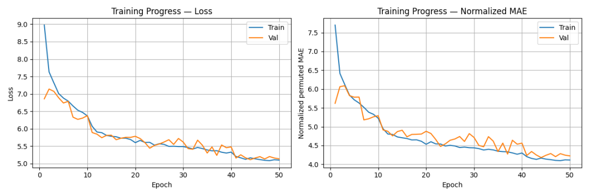
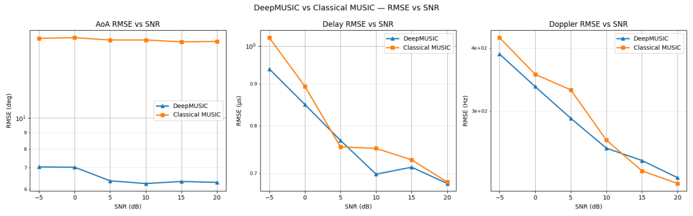
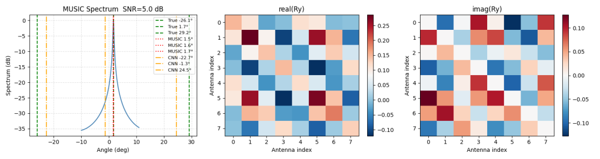
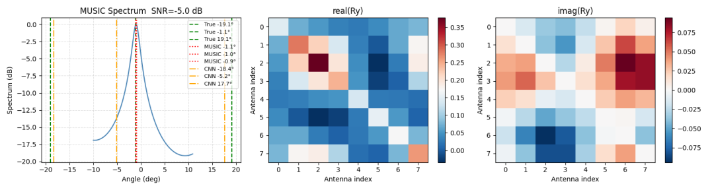

# Deep Learning Enhanced MUSIC Algorithm: A New Paradigm for OFDM MIMO Channel Parameter Estimation with Python Code

Deep learning enhanced MUSIC algorithm: OFDM MIMO channel parameter estimation new paradigm
Classic MUSIC relies on subspace orthogonality for DOA superresolution, but under low SNR, limited number of samples, and coherent multipath scenarios, the distortion in the covariance leads to estimation failure. DeepMUSIC avoids feature decomposition and grid spectrum search with data-driven methods, and DA-MUSIC integrates the physical prior of MUSIC into a differentiable network, achieving joint estimation of angle-time delay-Doppler parameters, representing the mainstream new approach for OFDM-MIMO integrated channel parameter estimation.
Introduction: From classic MUSIC to deep learning MUSIC
Proposed by Schmidt in 1979, its core principle is: array receiving covariance feature decomposition divides signal subspace / noise subspace; utilizes the orthogonality between the array steering vector and the noise subspace to construct a spatial pseudo spectrum, where the spectral peak corresponds to the source DOA, which is the foundational algorithm for array superresolution direction finding. However, there are prominent engineering challenges:
1. Reliance on accurate source number prediction, as incorrect source number judgment directly disrupts subspace division;
2. Low SNR and fewer samples lead to sample covariance deviating from statistical covariance, causing pseudo peak broadening, sidelobe elevation, and appearance of spurious peaks;
3. Coherent multipath reduces the rank of signal covariance, making traditional MUSIC fail, requiring additional decoupling preprocessing such as spatial smoothing and forward-backward smoothing;
4. Online computation involves high-dimensional feature decomposition + full angle grid traversal search, resulting in significant computational overhead at high grid resolution.
Cross-disciplinary solutions derived from deep learning and array signal processing include two categories:
DeepMUSIC (2018, Wu): CNN fitting "Covariance matrix → DOA" mapping, abandoning explicit feature decomposition and spectrum search, relying on massive simulation data to learn robust features against noise / sample disturbances;
DA-MUSIC (Deep Augmented MUSIC, 2021): A hybrid paradigm combining physical priors with data-driven approaches, incorporating gradient-differentiable feature decomposition and differentiated MUSIC spectrum computation within the network. The orthogonal constraints of MUSIC are incorporated as regularization into the network parameter optimization, balancing the traditional algorithm's physical interpretability with the deep learning's noise resistance advantages.
This paper focuses on OFDM-MIMO integrated systems, thoroughly examining two types of deep MUSIC architectures, invariant loss arrangements, and a three-dimensional joint estimation scheme for spatial, temporal, and frequency parameters. It also quantitatively compares the performance boundaries of traditional/deep algorithms.
System Model and Signal Description: 2.1 OFDM MIMO Transmission Channel Model: Single-site MIMO-OFDM (co-located transmitter and receiver, transmission angle = arrival angle): Transmit antenna, receive antenna; number of OFDM subcarriers, one frame contains how many OFDM symbols, subcarrier spacing, symbol period; the channel includes independent multipath components, including: complex attenuation, delay, Doppler shift, and spatial angle.
Under the pilot system, the reception of the first symbol and the first subcarrier:
- Transmitted pilot (known);
- Complex Gaussian white noise;
- Time-frequency coupled MIMO channel matrix:
- Uniform linear array steering vector at both transmitter and receiver (half-wavelength arraying);
- Frequency domain phase factor carrying time delay information;
- Time domain phase factor carrying Doppler information;
The model essence is to characterize angles in space dimension, delays in subcarrier dimension, and Doppler in OFDM symbol dimension, naturally supporting joint estimation of spatio-temporal-frequency parameters. 2.2 Sample Covariance Construction and Network Input Preprocessing: Full-time-frequency resource aggregation yields sample covariance (equivalent quick-look):
Complex numbers cannot be directly fed into CNNs; engineering unified preprocessing: separate the real and imaginary parts, concatenate them into a tensor (NHWC), serving as the original input for DeepMUSIC/DA-MUSIC.
III. Classic MUSIC Algorithm Principle Review: Feature Decomposition, where feature values are sorted in descending order: the first corresponds to signal features, and the second to noise features; the latter is used to form a subspace of noise; MUSIC space pseudo spectrum:
When the denominator approaches zero, spectral peaks protrude, and by traversing an angle grid, DOA estimates are obtained.
Core Shortcomings Summary:
1. Approaches towards optimality only hold under infinitely fast sampling, no noise, and ideal conditions for source number accuracy.
2. Finite samples + noise destroy the orthogonality of the subspace, leading to spectral peak degradation; coherent multipath rank deficiency, and subspace division fails.
IV. DeepMUSIC: End-to-End CNN Baseline Model (Pure Data Driven)
4.1 Network Topology Input: Covariance Real-Imaginary Tensor; Output: Dimensional Real Number Vector (Multipath DOA)
Convolution Stacking Structure:
Network Layers
Parameters
Configuration Explanation
Conv1
3×3 convolution kernel / 64 channels
BN+ReLU + spatial Dropout (0.2)
Conv2
3×3 convolution kernel / 128 channels
BN+ReLU + spatial Dropout (0.2)
Conv3
3×3 convolution kernel / 128 channels
BN+ReLU + spatial Dropout (0.2)
Fully Connected Link: Flatten → Dense (256,Drop0.2) → Dense (128,Drop0.2) → Dense ()
Design Logic: CNN extracts the local correlation of the covariance matrix in the spatial domain, implicitly learns the noise and finite fast sampling disturbance patterns, skipping feature decomposition and grid search for spectrum.
4.2 Multi-Objective Layout Invariant Loss (Core Design)
Multipath DOA labels are randomly ordered, and the network output order does not have a fixed mapping with true values, directly causing additional loss due to order misalignment if MSE is used directly. Two feasible solutions:
Exhaustive enumeration of RMSE (smaller applicable) exhaustive permutation of true values, traversing to select the prediction - true value matching error minimum combination for calculation loss; The factorial explosion makes it unsuitable for batch training.
2  
Sinkhorn soft assignment loss (DA-MUSIC standard, micro-global optimal matching) obtains a continuous microsoftable permutation matrix through Sinkhorn normalization iterations, replacing discrete arrangements, and introduces angle-wrapped distance (angle periodicity) as a measure:
End-to-end differentiable, compatible with backpropagation, is the mainstream loss for multi-objective DOA deep learning.
V. DA-MUSIC: Enhanced MUSIC (Hybrid Drive) 5.1 Design Intention DeepMUSIC completely abandons array and MUSIC physical knowledge, limiting generalization; DA-MUSIC transforms the steering vector, feature decomposition, and MUSIC orthogonal spectrum into differential operator embedding networks, constraining parameter optimization with MUSIC physical principles, achieving superior generalization performance under low SNR and small datasets compared to pure CNN.
5.2 Branch architecture (multiple parallel branches based on the number of receiving antennas) Single receiving antenna branch processing link (total number of parallel branches):
1  
Feature Slice: Extract the column of input covariance;
2  
GRU Temporal Feature Extraction: The real and imaginary parts serve as temporal steps, allowing GRU () to extract complex coupling features from column vectors.
3  
Covariance Reconstruction: Fully Connected Mapping → Reshape Division of Real and Imaginary Parts → Restoration of the Branch Covariance
4  
Differentiable feature decomposition: (Noise subspace);
5  
Differentiable MUSIC spectrum generation: fixed-directional vector dictionary (= number of angle grids), generates branch pseudo spectra by element-wise operation.
6  
Peak-based fine-tuning: The branch MUSIC spectrum is compressed into branch features through an FC network.
Global fusion: Concatenation of all branch feature → Three-layer fully connected + Dropout → Output individual DOA.
5.3 Training scheduling strategy: Decrease learning rate in segments: Epoch 1~10: (rapid convergence); Epoch 11~40: (fine optimization); Epoch 41~50: (convergence fine tuning); combined with early stopping + model saving, suppress overfitting, and loss still adopts Sinkhorn-ordered RMSE.
Essential: The objective of network training is no longer merely to fit DOA, but to optimize the covariance and noise subspaces of the branches, allowing the internally generated MUSIC spectrum peaks to precisely align with real angles. VI. Time-delay + Doppler joint estimation algorithm based on DOA decoupling: a priori time-frequency decoupling approach: DA/DeepMUSIC output → decouple in the spatial domain → extract time delay and Doppler separately in the time-frequency domain, avoiding the traditional 3D-MUSIC computational explosion by searching in three dimensions simultaneously:
1  
Constructing the spatial base matrix using estimated angles:
2  
Pseudo-inverse decoupling of single path time-frequency channels: denoted as the _a_th time-frequency complex coefficient;
3  
Delay Extraction (Subcarrier Dimensional Phase): Solving the Subcarrier Phase Slope;
4  
Doppler extraction (OFDM symbol dimension phase): solving the slope of symbol phase.
Advantages: Closed-form solution, no search operation; full-time frequency resource average noise reduction, parameter precision binding DOA estimation performance.
VII. Simulation Results Analysis () 7.1 DOA Estimation RMSE-SNR Curve 1
Traditional MUSIC has severe misalignment of covariance, RMSE > 2°; DeepMUSIC ~0.5°, DA-MUSIC optimally constrained by physical constraints (RMSE < 0.4°);
2  
The precision of three types of algorithms is synchronously raised, and the DA-MUSIC algorithm achieves the fastest approximation of the Cramér-Rao lower bound (CRLB).
3  
Under ideal conditions, the traditional MUSIC approaches DA-MUSIC performance, with pure DeepMUSIC still exhibiting a steady-state error of about 0.1°, confirming the long-term gain from physical priors.
7.2 Time delay & Doppler indicator angle error directly propagated to time-frequency parameters: At SNR = 10dB, DA-MUSIC derived parameters: Time delay RMSE ≈, Doppler RMSE ≈5Hz, which is about 3 times higher than the classical MUSIC.
7.3 Comparison of computational complexity 1
Classic MUSIC: Feature Decomposition + Point Grid Traversal, extremely high online overhead after grid encryption.
2  
DeepMUSIC: GPU inference with fixed compute power, independent of angle grids, and optimal for real-time performance.
3  
DA-MUSIC: Branch + Branch-wise Differentiable Feature Decomposition, computational complexity approximately equal to DeepMUSIC, but still significantly lower than high-resolution grid MUSIC.
Project Implementation Advantages: Offline massive data training, online only one forward propagation can achieve spatio-temporal-frequency three parameters joint output, adapt to radar / integrated real-time processing.
VIII. Summary and Future Research Directions
DeepMUSIC: purely data-driven, replace subspace decomposition and spectrum search with CNN to solve low SNR, few quick MUSIC failures.
2  
DA-MUSIC: A benchmark for the integration of physical models and deep learning, featuring embedded MUSIC operators that balance the interpretability of the algorithm with its robustness against interference.
3  
Decoupled Spatio-Temporal Frequency Parameter Estimation: Using DOA as a bridge, closed-loop acquisition of time delay and Doppler is achieved to realize intelligent full channel parameter estimation for OFDM-MIMO.
1. Extended development direction
Massive Array Optimization: In massive arrays, the explosion of covariance dimensions under sparse arrays leads to research on low-dimensional compression representation of covariance, reducing network input dimensions.
2  
Strong coherent multipath scenario: Network embedded microspace smoothing module, natively solves the rank deficiency problem of coherent sources.
3  
Adaptive Noise Robust Training: Noise variance is used as the network auxiliary input to achieve adaptive SNR estimation across the entire range.
4  
SDR Measurement: Based on USRP software radio, an OFDM-MIMO measurement platform is built to complete the air interface measurement method verification.
References:

## Images

<!-- PAYMENT_BLOCK -->

## Get this dataset

- Payment link (Stripe): [Buy now](https://buy.stripe.com/3cs8yP7sY87d0vu9AB)
- Payment QR code: 

<!-- /PAYMENT_BLOCK -->
